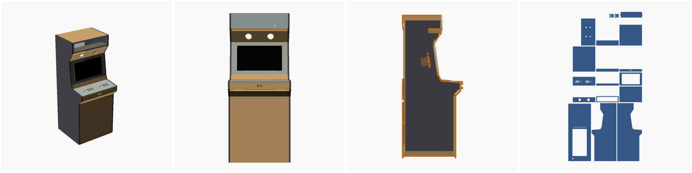
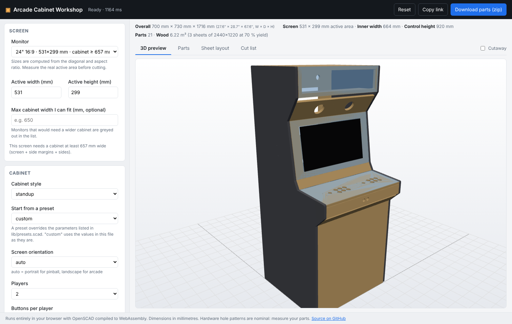
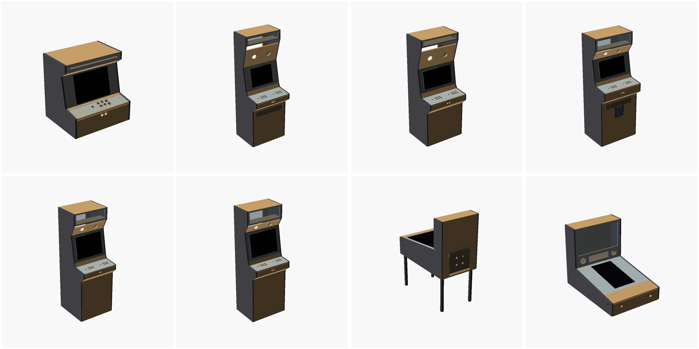
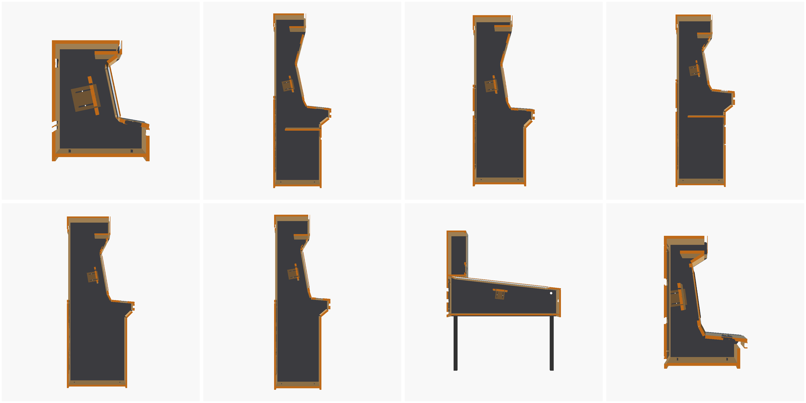
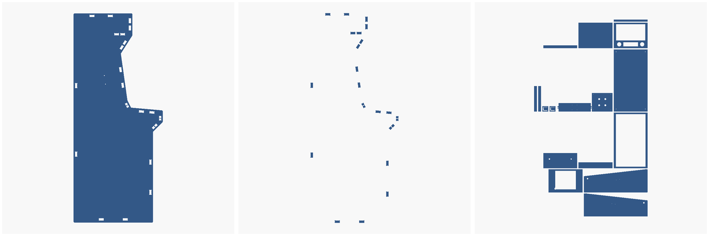

# Arcade Cabinet Workshop

A parametric **OpenSCAD cabinet generator for CNC-cut arcade and virtual pinball builds**.

Set a screen size, a cabinet style and your stock thickness; the generator derives a closed, buildable cabinet, previews it in 3D, exports every panel as a 2D part for CAM and prints a cut list.

> **Units:** millimetres. Check production dimensions against your actual monitor, controls, hardware and measured sheet thickness before cutting.



## Features

- Stand-up arcade, bartop arcade, full-size virtual pinball and bartop virtual pinball styles.
- **Screen-driven sizing.** Width, depth, head height and the whole side profile are solved from the visible screen size, margins, recline and control-panel geometry. Enter a cabinet width/depth/height only if you want to force one.
- **Closed by construction.** The side profile is generated from the stack of cross panels (top, marquee frame, upper bezel, screen panel, lower bezel, control panel, fascia, kick panel, front panel, rear panel, floor). Every face of the profile is covered, every butt joint is trimmed for stock thickness, and the geometry is checked by asserts (door and drawer openings fit their panels, the screen fits inside the body, the control panel clears the screen).
- Reference presets: `tinyarcade_bartop`, `koenigs_mame`, `compact_1600`, `asteroids`, `classic_80s`, `we_build_stuff`, `vpin_731x1308`, plus `custom`.
- One or two players, 4 to 8 buttons in a grid or arc layout, joystick and trackball hole patterns from named hardware templates, auxiliary and admin buttons on the fascia.
- Marquee with a real window and plexi, speaker holes in the upper bezel, coin door, keyboard drawer, rear service door with vents, cable hole, leveler holes.
- Fixed or adjustable VESA monitor mount (slotted rails for post-assembly depth adjustment).
- Joinery: screw guide holes, through tab/slot, or blind pockets (tab depth less than the stock) exported as separate pocket drawings for CAM.
- Virtual pinball: sloped playfield solved for the screen, apron, rear deck, legs and a full backbox with display, speaker and DMD openings.
- Output modes: 3D assembly (with cutaway), single 2D part, wood and plexi sheet overviews, bill of materials and part list in the console, plus `scene` / `all_sheet` for external viewers such as the web app.

## Web app

The `web/` folder holds a browser-only front end: pick a monitor, a style and your stock, watch the 3D preview update, and download a zip with a DXF and SVG for every part, the sheet layouts and the cut list. OpenSCAD runs in the browser as WebAssembly, so nothing is uploaded. It is published with GitHub Pages from `main` by `.github/workflows/pages.yml` (set the Pages source to "GitHub Actions" once in the repository settings). To run it locally:

```sh
web/build.sh _site && python3 -m http.server -d _site 8000
```



See `web/README.md` for how it drives the generator (`output_mode = "scene"` and `"all_sheet"`).

## Requirements

- [OpenSCAD](https://openscad.org/) 2021.01 or newer.
- A CAM package that imports DXF or SVG. Cutter compensation, feeds and speeds, hold-down and final nesting belong in CAM; the generator produces nominal geometry.

## Quick start

Open `arcade_cabinet_workshop.scad` in OpenSCAD. Every parameter is in that file, grouped for the Customizer. The `lib/` folder holds the implementation and does not need editing.

```scad
cabinet_style = "standup";      // standup, bartop, vpin, vpin_bartop
material_thickness = 18.0;
plexi_thickness = 3.0;

screen_width = 531;             // visible area of your monitor
screen_height = 299;
screen_recline_angle = 8;

players = 2;
buttons_per_player = 6;
button_layout = "arc";          // grid or arc

output_mode = "assembly";
```

1. Render the assembly and check the proportions. Turn on `show_cutaway` to see the interior.
2. Set `output_mode = "bom"` (F5) to read the cut list and overall size in the console.
3. Set `output_mode = "part_list"` to see the part names available for this configuration, then `output_mode = "part"` with `part_name = "left_side"` and export DXF or SVG for each part.
4. `wood_sheet` and `plexi_sheet` draw every part in rows for a quick overview. They are not an optimised nest.

### Command line

All parameters can be overridden with `-D`, which makes the generator easy to drive from scripts or a web front end:

```sh
openscad -o left_side.dxf -D 'output_mode="part"' -D 'part_name="left_side"' arcade_cabinet_workshop.scad
openscad -o bom.echo --export-format=echo -D 'output_mode="bom"' -D 'screen_width=598' -D 'screen_height=336' arcade_cabinet_workshop.scad
```

`tests/render_all.sh` renders every preset in every output mode plus every part and fails on any OpenSCAD warning, error or assertion. `tests/view.scad` is a render wrapper for fixed-camera PNGs (iso, side, cutaway, front, part, sheet).

## How the geometry is derived

The side profile is a closed polygon built from a list of faces, each of which may carry a cross panel. The main chain for an arcade cabinet, going up the front:

```
floor -> front panel -> kick panel -> control fascia -> control panel -> lower bezel
      -> screen panel -> upper bezel -> marquee frame -> top panel -> rear panel
```

Key dimensions and what drives them:

| Dimension | Driven by |
| --- | --- |
| Inner width | `screen_width + 2 * screen_side_margin`, or the player layout if that is wider |
| Screen panel length | `screen_height + 2 * screen_top_bottom_margin` |
| Screen panel position | `screen_gap_above_control` and `control_to_screen_clearance` from the control panel's rear edge |
| Head height | screen top, `standup_neck_rise`, marquee height. `cabinet_height` adds to the upper bezel if larger |
| Cabinet depth | `cabinet_depth` or an automatic value per style |
| Pinball depth | `vpin_rear_step + sqrt((screen_len + apron)^2 - rise^2)` when `cabinet_depth = 0` |

`panel_inset` sets every cross panel in from the side-panel edge (T-moulding reveal). Tab/slot joinery needs an inset large enough to keep the slots inside the side panel; the generator asserts the minimum.

## Presets

| Preset | Style | Notes |
| --- | --- | --- |
| `tinyarcade_bartop` | bartop | 10.1 in screen, 1 player, no marquee overhang |
| `koenigs_mame` | standup | 636 wide, keyboard drawer |
| `compact_1600` | standup | 1600 tall, 600 wide |
| `asteroids` | standup | 1892 tall, tall fascia, keyboard drawer and coin door. The drawn 1050 mm control height is high for most players |
| `classic_80s` | standup | 650 x 650 x 1850 |
| `we_build_stuff` | standup | 24 in screen, trackball |
| `vpin_731x1308` | vpin | 49 in portrait screen in a 1308 deep body, backbox |

A preset sets the parameters listed for it in `lib/presets.scad`, grouped as geometry, material, screen and controls. Each group can be switched off (`preset_use_*`) to combine, for example, a preset's body with your own screen.




## Hardware templates

`lib/hardware.scad` holds the joystick, trackball and button hole patterns (`sanwa_jlf`, `happ_competition`, `u_trak`, `japanese_30`, `japanese_24`, `american_28`). The values are nominal catalogue dimensions. **Measure your parts before cutting** and add a template if yours differ.

## Joinery and CAM notes

- `screw`: pilot holes in the side panels along each cross panel's centre line.
- `tab_slot` with `joinery_tab_depth >= material_thickness`: through slots in the sides, tabs on the cross panels, optional dogbone relief sized from `tool_diameter`.
- `tab_slot` with a smaller tab depth: blind pockets. The side-panel outline exports as `left_side` / `right_side` and the pocket outlines as `left_side_pockets` / `right_side_pockets`; cut the pockets to `joinery_tab_depth` before the profile.
- Inside corners of openings use the larger of the configured corner radius and the tool radius.



## Project layout

```
arcade_cabinet_workshop.scad   all parameters, includes lib/, output dispatch
lib/presets.scad               preset table and cfg() lookup
lib/hardware.scad              joystick / trackball / button templates
lib/geometry.scad              derived dimensions, face list, panel records, asserts
lib/joinery.scad               tabs, slots, pockets, dogbones
lib/parts2d.scad               2D drawing of every part
lib/assembly.scad              3D placement
lib/export.scad                part export, sheet layouts, BOM
tests/render_all.sh            renders every preset, mode and part; fails on warnings
tests/view.scad                PNG render wrapper
web/                           browser front end (OpenSCAD WebAssembly, Three.js preview, zip export)
.github/workflows/             render tests on every push; GitHub Pages deployment of web/
docs/renders/                  sample renders
```

## License

See the repository license.
